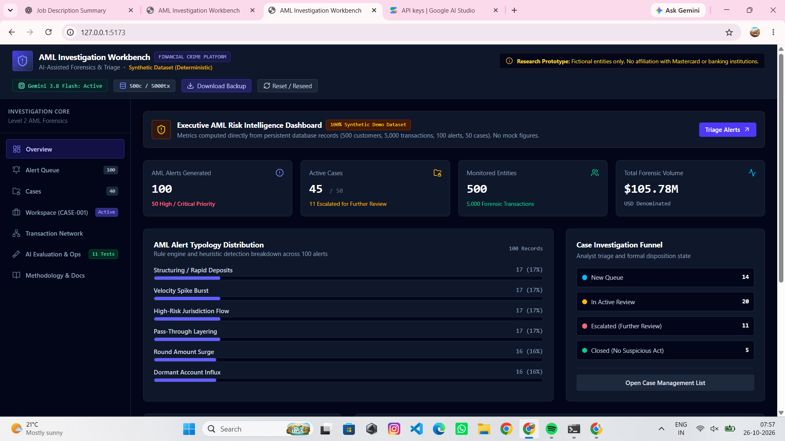
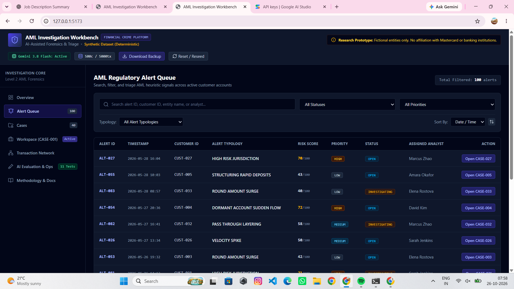
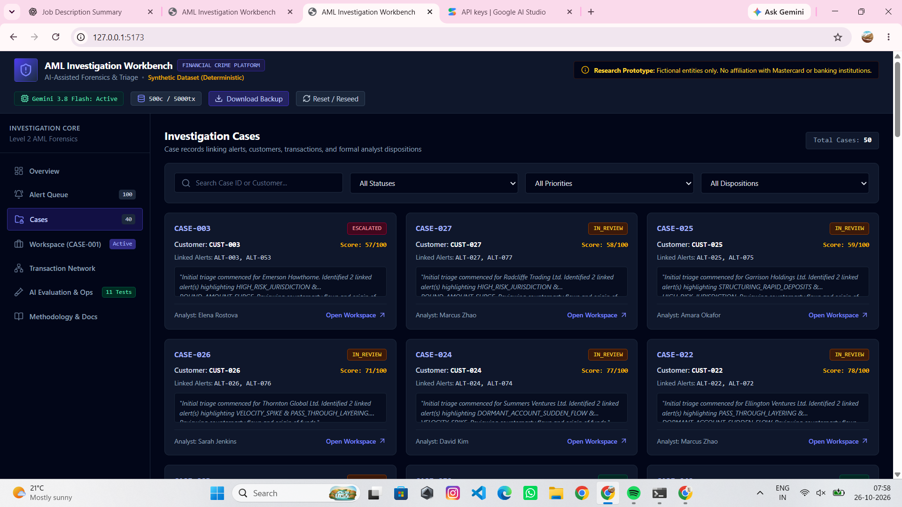
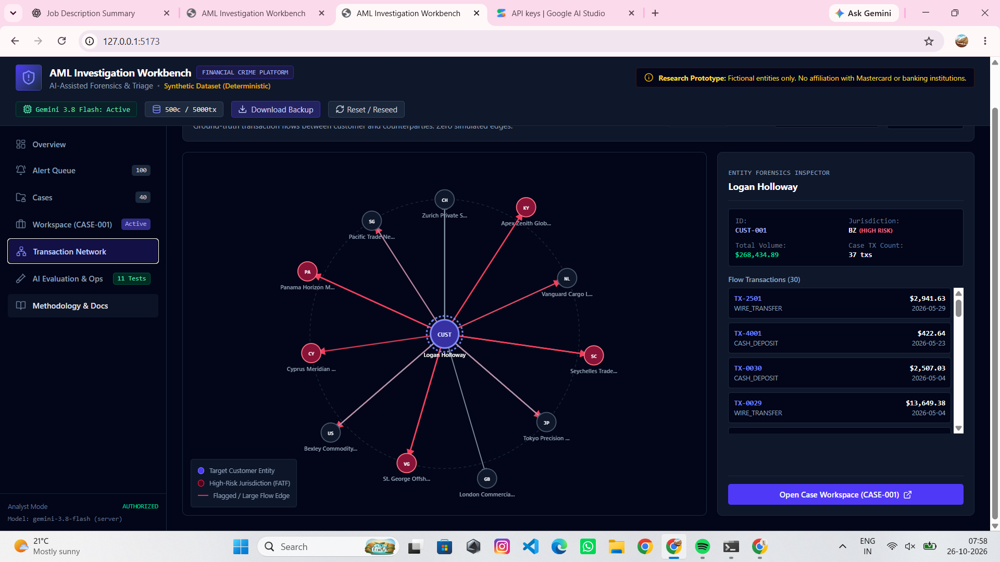
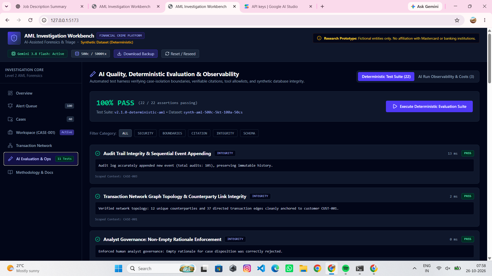

# AML Investigation Workbench

**Evidence-Grounded AML Investigations | Financial Crime Analytics | Responsible GenAI**

An independent portfolio project demonstrating how deterministic transaction analytics and AI-assisted investigation workflows can help analysts review synthetic anti-money-laundering (AML) alerts, examine transaction relationships, inspect supporting evidence, and document investigation outcomes.

> **Portfolio disclaimer:** This is an educational research prototype using synthetic data. It is not affiliated with or endorsed by Mastercard, SWIFT, any financial institution, or any regulatory authority. It is not intended for real-world financial crime decisions.

## Project Highlights

- **AML alert triage:** Review prioritized alerts across four synthetic financial crime typologies.
- **AI-assisted investigations:** Generate structured investigation dossiers using Google Gemini and case-scoped evidence.
- **Evidence citations:** Validate AI-generated citation identifiers against authorized evidence records.
- **Transaction network analysis:** Explore customer-to-counterparty relationships and directional transaction flows.
- **Analyst-controlled decisions:** Require a rationale for supported disposition changes; AI is advisory, not the decision-maker.
- **Audit and reporting:** Record investigation events and export case dossiers as PDF reports.
- **Automated evaluations:** Run an 11-check evaluation suite covering integrity, evidence handling, isolation, governance, and other controls.

## Application Screenshots

Screenshots below should be captured from the actual running application.

| Overview Dashboard | Alert Queue |
|---|---|
|  |  |

| Case Workspace | Transaction Network |
|---|---|
|  |  |

| Evaluation Results |
|---|
|  |

## The Problem

AML analysts may need to review large volumes of alerts, reconstruct transaction flows, compare customer activity, and document the evidence behind an investigation.

AI can help organize that work, but an unconstrained language model may produce unsupported statements, cite nonexistent records, or cross investigation boundaries.

This project explores a more controlled approach: combine deterministic data retrieval and analytics with AI-generated summaries, validate evidence references, and retain human responsibility for investigation outcomes.

## Key Features

### 1. Alert Triage and Case Management

- Review alerts by severity, status, priority, and typology.
- Explore associated customers and transaction records.
- Work with existing investigation cases and supported disposition workflows.

### 2. Case-Scoped AI Investigation

The backend uses Google's `@google/genai` SDK to request a structured investigation dossier from Gemini.

The workflow is designed to:

1. Assemble evidence for the selected case.
2. Provide the model with authorized evidence references.
3. Request a structured investigation response.
4. Validate citation identifiers against the evidence index.
5. Present the result for analyst review.

AI-generated findings are advisory and must not be treated as proof of financial crime.

### 3. Transaction Network Analysis

Explore directional relationships between customers and counterparties to investigate transaction movement, connected entities, and potential layering patterns.

Network relationships are analytical leads, not proof of illicit intent.

### 4. Analyst Governance and Audit Events

- AI investigation tools are designed to be read-only.
- Supported disposition changes require an analyst-provided rationale.
- Investigation actions and related events are recorded in an audit history.

The audit implementation is a portfolio demonstration, not a certified tamper-proof regulatory audit system.

### 5. PDF Case Reports

Generate PDF investigation dossiers for review and documentation. Reports can consolidate case context, transaction information, investigation findings, and available audit details.

### 6. Evaluation Suite

The application includes 11 deterministic evaluation checks. In the local test run, all 11 checks passed.

Coverage includes:

1. Duplicate seed prevention and persistence idempotency.
2. Referential integrity.
3. Cross-case isolation.
4. Unauthorized tool invocation rejection.
5. Read-only AI tool enforcement.
6. Evidence bundle and citation stability.
7. Transaction record verification.
8. Deterministic risk heuristics.
9. Transaction network relationships.
10. Mandatory analyst rationale enforcement.
11. Audit event appending and integrity.

These are application-level checks, not independent security certification or proof of production readiness.

## Synthetic Dataset

The local application is seeded with synthetic records.

| Entity | Records |
|---|---:|
| Customers | 500 |
| Transactions | 5,000 |
| Alerts | 100 |
| Cases | 50 |

### Demonstrated AML Typologies

- **Structuring / smurfing:** Transaction patterns involving repeated transfers near configured thresholds.
- **Rapid movement / layering:** Funds moving through multiple counterparties over short periods.
- **Shell-company velocity:** Unusual transaction activity associated with synthetic corporate entities.
- **Jurisdiction spikes:** Changes in synthetic cross-border transaction patterns.

All records are synthetic. The scenarios do not establish that any real person or organization has engaged in financial crime.

## Architecture

```text
React + TypeScript Frontend
           |
           | /api requests
           v
      Express Backend
           |
           +---- Persistent JSON Store
           |
           +---- Case-Scoped Evidence Tools
           |
           +---- Gemini Investigation Service
           |
           +---- Deterministic Evaluations
           |
           +---- PDF Report Generation
```

### Technology Stack

| Layer | Technologies |
|---|---|
| Frontend | React 19, TypeScript, Vite 8 |
| Styling | Tailwind CSS 4 |
| Backend | Node.js, Express, TypeScript |
| AI integration | Google GenAI SDK, Gemini |
| Persistence | Local JSON file store |
| Reporting | PDFKit |
| Quality checks | TypeScript checks, production build, application evaluation suite |

## Run Locally on Windows

### Prerequisites

- Node.js and npm.
- Git.
- A Google AI Studio API key if you want to run AI investigations.

### 1. Clone the repository

Replace the repository URL below with the actual public URL of this project.

```cmd
git clone YOUR_REPOSITORY_URL
cd AML-Investigation-Workbench-
```

### 2. Install dependencies

```cmd
npm install
```

### 3. Configure the environment

Create a local `.env` file in the project root. Use `.env.example` as a reference.

```env
PORT=3000
GEMINI_API_KEY=YOUR_PRIVATE_API_KEY
```

Replace the placeholder locally with your own key. Do not commit `.env`, share your key, or expose it in frontend code.

### 4. Start the backend

Open Command Prompt in the project directory and run:

```cmd
npm run dev
```

Keep this terminal open. The backend listens on port `3000`.

### 5. Start the frontend

Open a second Command Prompt in the same project directory and run:

```cmd
npx vite --host 127.0.0.1
```

Open the local URL printed by Vite, normally:

```text
http://127.0.0.1:5173/
```

The frontend uses the Vite `/api` proxy to communicate with the backend.

### 6. Verify the production build

```cmd
npm run build
```

The production build has been verified successfully in the development environment used for this project.

## Security and Responsible AI

This project demonstrates selected safeguards:

- API credentials are intended to remain server-side.
- Investigation evidence is scoped to a selected case.
- Citation identifiers are validated against authorized evidence.
- AI tools are restricted from performing supported case mutations.
- Analyst dispositions require a rationale.
- Synthetic data is used instead of real banking records.

These safeguards have not been independently certified. A real deployment would require additional threat modeling, authentication, authorization, access controls, monitoring, privacy review, regulatory assessment, and security testing.

## Limitations and Future Improvements

Potential future work includes:

- PostgreSQL-backed persistence and database migrations.
- Authentication, role-based access controls, and multi-user support.
- Expanded automated adversarial and regression testing.
- Improved AI latency, error handling, and investigation traceability.
- Configurable risk thresholds and analyst feedback.
- Deployment with secure secrets management and operational monitoring.

## Author

**Vishal Singh**

Data Analytics | Financial Crime Analytics | Responsible GenAI

- GitHub: [vishaaaal15](https://github.com/vishaaaal15)
- LinkedIn: [Vishal Singh](https://www.linkedin.com/in/vishal-singh-analytics/)

## License

This project uses the MIT License if the repository's `LICENSE` file confirms those terms.
